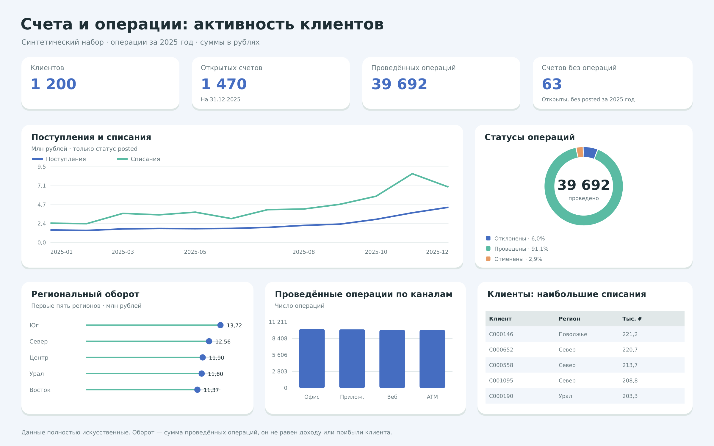

# Активность клиентов и банковские операции

Учебный анализ трёх связанных таблиц: customers, accounts и transactions. Задача — посчитать проведённые операции, сравнить поступления и списания, посмотреть активность счетов и регионов.

## Данные

Полностью искусственный набор: 1 200 клиентов, 1 652 счёта и 43 587 операций. Период операций — 2025 год, дата среза — 31.12.2025. Валюта RUB. Набор уже подготовлен; генерация данных не входит в проект.

| Таблица | Строк |
| --- | --- |
| customers | 1 200 |
| accounts | 1 652 |
| transactions | 43 587 |

## Подготовка

- Суммы переведены из копеек в рубли. Другие значения синтетического набора сохранены.

## SQL-вопросы

| Номер в analysis.sql | Вопрос |
| --- | --- |
| 1 | Сколько клиентов, счетов и операций? |
| 2 | Какие типы счетов есть в наборе? |
| 3 | Как распределены статусы операций? |
| 4 | Кто входит в топ-10 по проведённым списаниям? |
| 5 | Кто входит в топ-10 по поступлениям? |
| 6 | Какие счета имеют больше всего проведённых операций? |
| 7 | Как менялись поступления и списания по месяцам? |
| 8 | У каких открытых счетов не было операций в 2025 году? |
| 9 | У каких клиентов ровно один счёт? |
| 10 | Какие каналы используются чаще? |
| 11 | Как распределён проведённый оборот по регионам? |
| 12 | Сколько счетов открыто на дату среза? |

## Основные результаты

| Показатель | Значение |
| --- | --- |
| Открытых счетов | 1 470 |
| Проведённых операций | 39 692 |
| Открытых счетов без posted за 2025 год | 63 |
| Клиентов с одним счётом | 740 |

## Статусы операций

| Статус | Количество |
| --- | --- |
| declined | 2 624 |
| posted | 39 692 |
| reversed | 1 271 |

## Региональный оборот

| Регион | Клиентов с posted | Операций | Оборот, руб. |
| --- | --- | --- | --- |
| South | 168 | 6 530 | 13 721 015,59 |
| North | 160 | 6 065 | 12 559 610,66 |
| Central | 163 | 5 959 | 11 902 053,02 |
| Ural | 152 | 5 795 | 11 800 358,26 |
| East | 176 | 5 917 | 11 365 882,93 |
| West | 164 | 5 225 | 10 240 422,65 |
| Volga | 138 | 4 201 | 9 145 725,21 |

## Что можно сказать по результатам

- В оборот входят только операции posted. Отклонённые и отменённые операции остаются в таблице, но не увеличивают денежные суммы.
- У **63 открытых счетов** нет проведённых операций за 2025 год. Среди них могут быть недавно открытые счета; это список для изучения, а не готовый вывод о потере клиента.
- Наибольший проведённый оборот в этом искусственном наборе — у региона South. Оборот включает поступления и списания и не является доходом или прибылью клиента.
- JOIN связывает клиента с его счетами и операциями. COUNT(DISTINCT customer_id) в региональной сводке позволяет не считать одного клиента заново для каждой операции.
- Топы поступлений и списаний — отдельные списки. Поступления не называются зарплатой: в наборе нет назначения платежа, которое позволило бы это определить.

## Файлы

| Файл | Назначение |
| --- | --- |
| analysis.sql | Все основные запросы с комментариями |
| data/*.csv | Подготовленный датасет, по файлу на таблицу |
| data/analysis.sqlite | Готовая база с этими же таблицами |
| dashboard.png | Статичная визуализация SQL-результатов |

## Источник задания и данных

[Пример franklinanalytics](https://github.com/franklinanalytics/Bank-Segmentation-Analysis). Сохранены темы счетов, активности, операций и регионов. Здесь используется ранее подготовленный синтетический набор с рублёвыми суммами (CC0 1.0), а не нигерийские данные автора. Генератор PostgreSQL, зарплатные назначения и сложные рейтинги из оригинала в эту учебную версию не перенесены.

