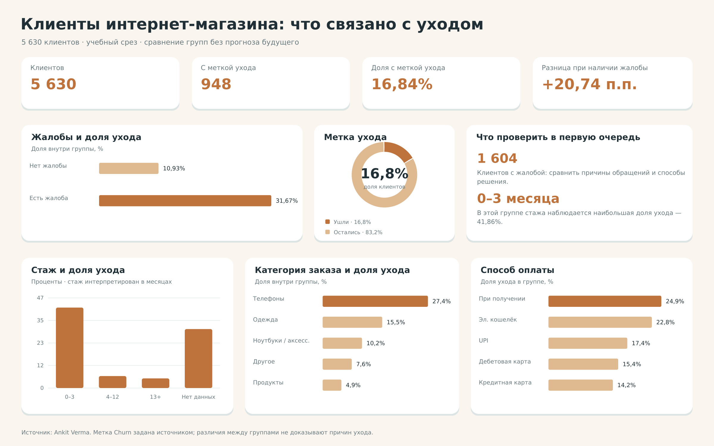

# Отток клиентов интернет-магазина

Учебный SQL-анализ: посмотреть долю клиентов с меткой ухода и сравнить её по стажу, жалобам, оплате и другим признакам. Основные приёмы — группировки, средние значения и CASE.

## Данные

5 630 строк; одна строка — клиент. Churn = 1 означает уход по метке источника, Churn = 0 — отсутствие этой метки. Дат событий и периода определения ухода в наборе нет.

| Таблица | Строк |
| --- | --- |
| customers | 5 630 |

## Подготовка

- Унифицированы Phone/Mobile Phone, CC/Credit Card, COD/Cash on Delivery и Mobile/Mobile Phone.
- Пропуски оставлены пустыми: они не заменялись средними или нулями.

## SQL-вопросы

| Номер в analysis.sql | Вопрос |
| --- | --- |
| 1 | Сколько клиентов в наборе и какая доля ушла? |
| 2 | В каких основных полях есть пропуски? |
| 3 | Какая доля ухода у пользователей телефона и компьютера? |
| 4 | Как отличается доля ухода по типу города? |
| 5 | Как отличаются способы оплаты? |
| 6 | Как различается доля ухода по полу? |
| 7 | Как распределён уход по оценке удовлетворённости? |
| 8 | Как различается доля ухода по семейному статусу? |
| 9 | Как связаны жалобы и доля ухода? |
| 10 | Как связаны число устройств и доля ухода? |
| 11 | В каких категориях больше уходов? |
| 12 | Как отличается доля ухода по стажу? |
| 13 | Как отличается доля ухода по расстоянию до склада? |
| 14 | Чем в среднем отличаются ушедшие и оставшиеся? |

## Основные результаты

| Показатель | Значение |
| --- | --- |
| Клиентов | 5 630 |
| С меткой ухода | 948 |
| Доля ухода | 16,84% |

## Жалобы и уход

| Жалоба | Клиентов | Доля ухода |
| --- | --- | --- |
| Есть | 1 604 | 31,67% |
| Нет | 4 026 | 10,93% |

## Стаж клиента

| Стаж | Клиентов | Доля ухода |
| --- | --- | --- |
| 0–3 месяца | 1 560 | 41,86% |
| 13+ месяцев | 1 896 | 5,01% |
| 4–12 месяцев | 1 910 | 6,23% |
| Неизвестен | 264 | 30,68% |

## Что можно сказать по результатам

- У клиентов с жалобой доля ухода — **31,67%**, без жалобы — **10,93%**. Разница 20,74 п.п. показывает, с какой группы стоит начать изучение обращений.
- Среди клиентов с известным стажем наибольшая доля ухода у группы 0–3 месяца: **41,86%**. Можно отдельно посмотреть первые заказы и сложности новых покупателей.
- В категории Mobile Phone доля ухода — **27,40%**. Для интерпретации нужно учитывать и размер группы: в ней 2 080 клиентов.
- У 264 клиентов не указан стаж. Такие записи выделены в Unknown. Сравнения описывают связи в снимке и не доказывают причины ухода.

## Файлы

| Файл | Назначение |
| --- | --- |
| analysis.sql | Все основные запросы с комментариями |
| data/*.csv | Подготовленный датасет, по файлу на таблицу |
| data/analysis.sqlite | Готовая база с этими же таблицами |
| dashboard.png | Статичная визуализация SQL-результатов |

## Как открыть

1. Распакуйте папку проекта и откройте data/analysis.sqlite в [DB Browser for SQLite](https://sqlitebrowser.org/) или другом редакторе SQLite.
2. На вкладке Execute SQL откройте analysis.sql.
3. Выделите нужный блок от SELECT до точки с запятой и выполните его. Номера блоков совпадают с таблицей вопросов выше.

Запросы можно выполнять отдельно. Они читают таблицы и не меняют исходные данные. Устанавливать библиотеки или запускать скрипты подготовки для просмотра не требуется.

## Источник задания и данных

[Пример задания Judithokon](https://github.com/Judithokon/Ecommerce-Customer-Churn-Analysis-Using-SQL). Использован открытый набор [Ankit Verma / Ecommerce Customer Churn](https://www.kaggle.com/datasets/ankitverma2010/ecommerce-customer-churn-analysis-and-prediction), версия 1. Данные — CC BY-NC-SA 4.0. Запросы написаны для этой учебной версии; результаты могут отличаться от примера из-за правил обработки пропусков.

SQL этой версии — MIT, условия приведены в LICENSE. Условия для данных указаны отдельно выше.
