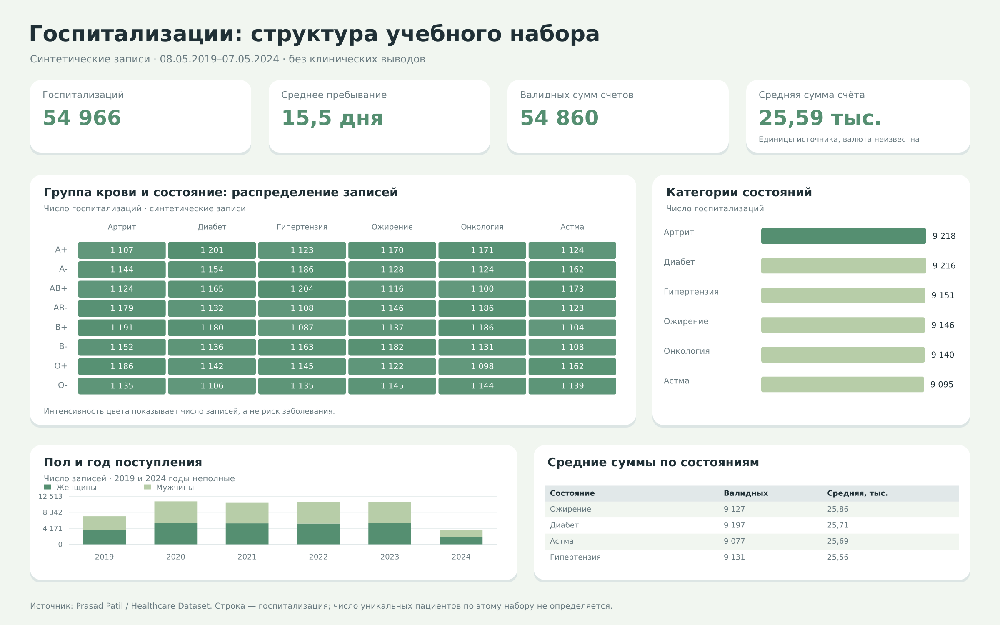

# Анализ учебного набора госпитализаций

Описательный SQL-анализ синтетических госпитализаций: состояния, возрастные группы, пол, счета и типы поступления. Используются COUNT, AVG, GROUP BY и CASE.

## Данные

В исходном файле 55 500 строк. После удаления 534 полных совпадений осталось 54 966. Строка — госпитализация, не уникальный пациент. Все данные искусственные, валюта сумм счетов не указана.

| Таблица | Строк |
| --- | --- |
| admissions | 54 966 |

## Подготовка

- Удалено полных совпадений всех исходных полей: 534.
- Отрицательные суммы счетов (106) оставлены пустыми; сами записи сохранены.
- Добавлены номер записи admission_id и число дней между поступлением и выпиской.

## SQL-вопросы

| Номер в analysis.sql | Вопрос |
| --- | --- |
| 1 | Сколько записей и какова средняя длительность пребывания? |
| 2 | Какие состояния встречаются в записях чаще? |
| 3 | Как распределены состояния по годам? |
| 4 | Как распределены состояния по возрастным группам? |
| 5 | Как распределены записи по полу и годам? |
| 6 | Как распределены состояния по полу? |
| 7 | Какова средняя сумма счёта по состояниям? |
| 8 | Как различаются суммы по страховым группам и состояниям? |
| 9 | Как распределены записи по группе крови и состояниям? |
| 10 | Как распределены типы госпитализации? |
| 11 | Как менялось число госпитализаций по годам? |

## Основные результаты

| Показатель | Значение |
| --- | --- |
| Госпитализаций | 54 966 |
| Среднее пребывание | 15,50 дня |
| Валидных сумм счетов | 54 860 |
| Средняя валидная сумма | 25 594,63 |

## Категории состояний

| Состояние | Госпитализаций | Среднее, дней |
| --- | --- | --- |
| Arthritis | 9 218 | 15,50 |
| Diabetes | 9 216 | 15,43 |
| Hypertension | 9 151 | 15,44 |
| Obesity | 9 146 | 15,45 |
| Cancer | 9 140 | 15,50 |
| Asthma | 9 095 | 15,68 |

## Количество по годам

| Год | Госпитализаций |
| --- | --- |
| 2019 | 7 300 |
| 2020 | 11 172 |
| 2021 | 10 816 |
| 2022 | 10 915 |
| 2023 | 10 936 |
| 2024 | 3 827 |

## Что можно сказать по результатам

- Самая частая метка в записях — **Arthritis: 9 218 госпитализаций**. Остальные пять групп имеют близкие значения, что характерно для этого синтетического набора.
- Среднее пребывание — **15,50 дня**. Сравнение групп показывает описательные различия, но не позволяет оценивать качество лечения.
- В 106 строках сумма счёта отрицательна. Она заменена пустым значением, а госпитализация сохранена. Поэтому COUNT(*) и COUNT(billing_amount) дают разные результаты.
- Первый и последний годы охвачены частично: 08.05.2019–07.05.2024. Снижение в 2024 году нельзя трактовать как падение потока за полный год.
- Матрица «группа крови × состояние» показывает число записей. По таким искусственным данным нельзя делать вывод о риске заболевания или причинной связи.

## Файлы

| Файл | Назначение |
| --- | --- |
| analysis.sql | Все основные запросы с комментариями |
| data/*.csv | Подготовленный датасет, по файлу на таблицу |
| data/analysis.sqlite | Готовая база с этими же таблицами |
| dashboard.png | Статичная визуализация SQL-результатов |

## Источник задания и данных

[Пример Gizelle Felix](https://www.kaggle.com/code/gizellef/healthcare-data-analysis-using-sql). Данные: [Prasad Patil / Healthcare Dataset](https://www.kaggle.com/datasets/prasad22/healthcare-dataset), версия 2, CC0 1.0. В этом проекте собственная базовая очистка, поэтому число строк отличается от примера автора.

