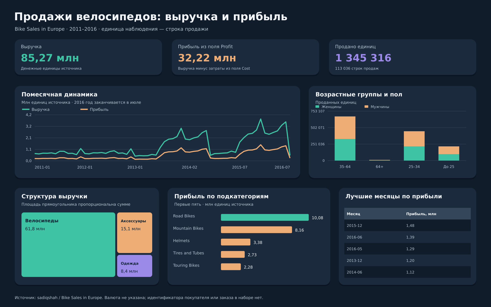

# Продажи велосипедов и аксессуаров

Учебный SQL-анализ продаж: фильтрация по стране и продукту, группировки по времени, категориям, возрасту и полу. В исходных данных уже есть выручка, затраты и прибыль.

## Данные

113 036 строк за 2011-01-01 — 2016-07-31. Одна строка — запись продажи. В наборе нет ID покупателя или номера заказа, поэтому COUNT(*) обозначает строки, а не число покупателей или заказов. Sale_id — технический номер записи. Валюта не указана.

| Таблица | Строк |
| --- | --- |
| sales | 113 036 |

## Подготовка

- Пол приведён к Male/Female, добавлен технический номер строки sale_id.
- Цены, затраты, выручка и прибыль сохранены из источника. Совпадающие строки не удалялись: номера заказа в наборе нет.

## SQL-вопросы

| Номер в analysis.sql | Вопрос |
| --- | --- |
| 1 | Каковы общие показатели продаж? |
| 2 | Пример фильтра: покупатели 25 лет в Германии 9 декабря 2013 года |
| 3 | Пример поиска продуктов по части названия |
| 4 | Десять строк Австралии с самым большим количеством |
| 5 | Какова сумма затрат в выбранном срезе? |
| 6 | Сколько строк продаж приходится на каждый возраст? |
| 7 | Как менялись выручка и прибыль по годам? |
| 8 | Какие пять месяцев дали наибольшую прибыль? |
| 9 | Как распределены строки продаж и количество по полу? |
| 10 | Какие страны и регионы дают наибольшую выручку? |
| 11 | Какие подкатегории дают наибольшую прибыль? |
| 12 | Как распределены выручка и прибыль по категориям? |
| 13 | Как распределено количество по возрастным группам и полу? |
| 14 | Как выглядит помесячная динамика выручки и прибыли? |

## Основные результаты

| Показатель | Значение |
| --- | --- |
| Продано единиц | 1 345 316 |
| Выручка | 85 271 008 |
| Затраты из поля Cost | 53 049 908 |
| Прибыль из поля Profit | 32 221 100 |

## Показатели по годам

| Год | Выручка | Прибыль |
| --- | --- | --- |
| 2011 | 8 964 888 | 2 881 301 |
| 2012 | 9 175 983 | 2 951 993 |
| 2013 | 15 240 037 | 5 959 208 |
| 2014 | 14 152 724 | 5 864 087 |
| 2015 | 20 023 991 | 7 528 563 |
| 2016 | 17 713 385 | 7 035 948 |

## Категории товаров

| Категория | Количество | Выручка | Прибыль |
| --- | --- | --- | --- |
| Bikes | 36 411 | 61 782 134 | 20 519 276 |
| Accessories | 1 054 162 | 15 117 992 | 8 862 377 |
| Clothing | 254 743 | 8 370 882 | 2 839 447 |

## Первые пять подкатегорий по прибыли

| Подкатегория | Прибыль |
| --- | --- |
| Road Bikes | 10 078 875 |
| Mountain Bikes | 8 160 463 |
| Helmets | 3 380 203 |
| Tires and Tubes | 2 727 713 |
| Touring Bikes | 2 279 938 |

## Что можно сказать по результатам

- Наибольшая сумма прибыли в наборе приходится на **2015 год: 7 528 563**. Наполненность лет различается; 2016 год заканчивается 31 июля, поэтому его нельзя сравнивать с полным годом как равный период.
- Велосипеды дают наибольшую выручку и прибыль, а аксессуары — наибольшее количество проданных единиц. Лидер по количеству и лидер по сумме могут отличаться.
- Лидирующая подкатегория по прибыли — **Road Bikes**. Для дальнейшего изучения можно посмотреть конкретные продукты и месяцы продаж этой группы.
- Самый прибыльный месяц в данных — **2015-12**, сумма 1 479 542.
- Для затрат используется SUM(cost), а не COUNT(cost): первая функция складывает деньги, вторая считает заполненные строки. Profit — исходный показатель набора, без дополнительного расчёта расходов бизнеса.

## Файлы

| Файл | Назначение |
| --- | --- |
| analysis.sql | Все основные запросы с комментариями |
| data/*.csv | Подготовленный датасет, по файлу на таблицу |
| data/analysis.sqlite | Готовая база с этими же таблицами |
| dashboard.png | Визуализация SQL-результатов |

## Источник задания и данных

[Пример emirakyer](https://www.kaggle.com/code/emirakyer/sql-sales-data-analysis). Его входной датасет помечен как Private Dataset. Для воспроизводимой версии использован публичный набор [sadiqshah / Bike Sales in Europe](https://www.kaggle.com/datasets/sadiqshah/bike-sales-in-europe), версия 1, с теми же основными полями. Это адаптация задания на открытой копии данных; результаты не выдаются за результаты закрытого файла. Лицензия данных в метаданных источника — Unknown.
