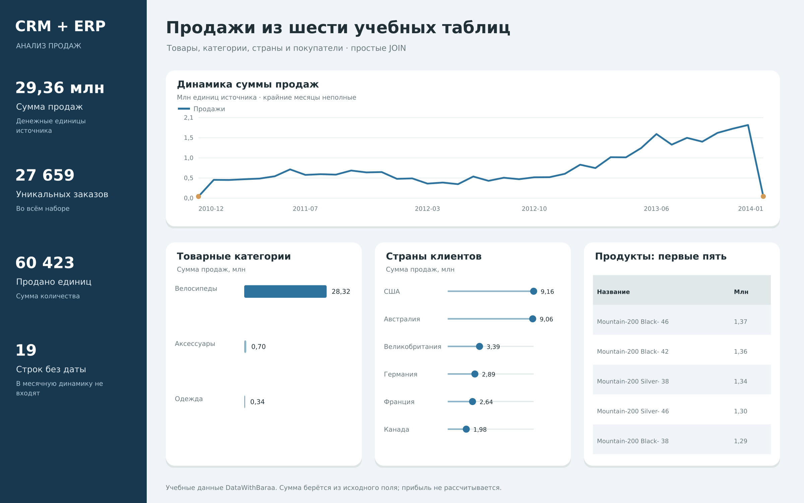

# Продажи из CRM и ERP

Учебный анализ продаж из двух систем. Задача — связать продажи с товарами, категориями и клиентами, получить сводки по месяцам и странам. Используются обычные JOIN по идентификаторам.

## Данные

Шесть таблиц: sales, products, customers, categories, locations, customer_details. В sales — 60 398 строк. Одна строка — позиция продажи; номер заказа может встречаться несколько раз. Валюта источника не указана.

| Таблица | Строк |
| --- | --- |
| customers | 18 484 |
| products | 295 |
| sales | 60 398 |
| customer_details | 18 484 |
| locations | 18 484 |
| categories | 37 |

## Подготовка

- Убраны пробелы в текстах и повторы идентификаторов справочников; для товара оставлена последняя запись.
- Коды товаров и клиентов приведены к одному виду, даты — к YYYY-MM-DD. Некорректные даты и отрицательные суммы оставлены пустыми.
- Суммы не восстанавливались по цене и количеству. Это простой анализ исходных продаж, без построения хранилища и его пересборки.

## SQL-вопросы

| Номер в analysis.sql | Вопрос |
| --- | --- |
| 1 | Сколько продаж, заказов и проданных единиц? |
| 2 | Как выглядят первые строки продаж? |
| 3 | Сколько строк без даты и без суммы? |
| 4 | Как менялись суммы продаж по месяцам? |
| 5 | Какие категории дают больше продаж? |
| 6 | Какие десять продуктов дают наибольшую сумму? |
| 7 | Какие суммы приходятся на страны клиентов? |
| 8 | Кто входит в десять покупателей с наибольшей суммой? |
| 9 | Как соотносятся значения пола в CRM и ERP? |
| 10 | Какие клиенты не имеют продаж в этом наборе? |

## Основные результаты

| Показатель | Значение |
| --- | --- |
| Строк продаж | 60 398 |
| Уникальных заказов | 27 659 |
| Продано единиц | 60 423 |
| Сумма исходных валидных продаж | 29 355 609,00 |

## Категории

| Категория | Количество | Сумма продаж |
| --- | --- | --- |
| Bikes | 15 205 | 28 316 272,00 |
| Accessories | 36 112 | 700 048,00 |
| Clothing | 9 106 | 339 289,00 |

## Страны клиентов: первые пять

| Страна | Заказов | Сумма продаж |
| --- | --- | --- |
| United States | 9 230 | 9 162 009,00 |
| Australia | 6 718 | 9 060 045,00 |
| United Kingdom | 3 031 | 3 391 328,00 |
| Germany | 2 484 | 2 894 007,00 |
| France | 2 484 | 2 643 779,00 |

## Что можно сказать по результатам

- Велосипеды дают около **96,46%** суммы продаж. Небольшие категории стоит смотреть отдельно, чтобы они не терялись за основной.
- США и Австралия дают наибольшие суммы. Здесь страна относится к клиенту из справочника; это не отдельное поле адреса доставки.
- В наборе 19 строк без корректной даты заказа и 11 без корректной суммы. Недатированные строки не входят в месячную динамику; SUM не учитывает пустые суммы.
- Первые и последние месяцы неполные. Для продукта взяты последние доступные сведения. Историческую прибыль и изменение свойств товара этот проект не рассчитывает.
- Сравнение пола из CRM и ERP показывает, зачем соединять таблицы и проверять согласованность справочников. В выборке нет клиентов без продаж.

## Файлы

| Файл | Назначение |
| --- | --- |
| analysis.sql | Все основные запросы с комментариями |
| data/*.csv | Подготовленный датасет, по файлу на таблицу |
| data/analysis.sqlite | Готовая база с этими же таблицами |
| dashboard.png | Статичная визуализация SQL-результатов |

## Источник задания и данных

[Исходное задание DataWithBaraa](https://github.com/DataWithBaraa/sql-data-warehouse-project), данные — MIT, снимок 34d06e5f808183d010b9a506bbd30aebd4a00fab. Здесь выполнена простая аналитическая часть на CSV и SQLite. Суммы берутся из исходного поля после базовой очистки; они могут отличаться от версии с восстановлением цен и сумм.
